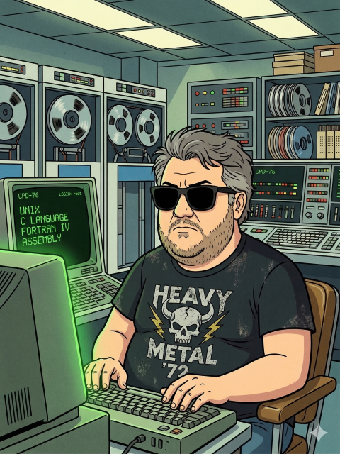

# goBaDig

**Basic Dignified Suite, em Go** — um pré-processador de BASIC para
**MSX**, **ZX81** e **ZX Spectrum**, com CLI, TUI e GUI, e um VSIX único
para VSCode cobrindo os três dialetos.

> Status: **stub funcional** (última release v1.1.4; desenvolvimento
> v1.2.0). Tem `--help`, `--man`, console interativo com temas e Tab e
> temas na GUI. A TUI está em redesign: `Setup > Install` congela e será
> refeita na próxima sessão; ainda não há conversor/tokenizer de BASIC.
> Ver [`OUTLINE.md`](OUTLINE.md) para o
> plano completo e o estado real de cada bloco de trabalho, e
> [`resume.txt`](resume.txt) (local, não versionado) para retomar o
> trabalho de uma sessão para outra.

## O que é

**Basic Dignified** é uma forma de programar os BASICs clássicos de
computadores de 8 bits num paradigma moderno: sem números de linha,
com labels, indentação, macros (`DEFINE`), arquivos incluídos
(`INCLUDE`), nomes de variável longos, uma espécie de função
(`FUNC`/`RET`), operadores compostos, `TRUE`/`FALSE`, caracteres
gráficos via Unicode (onde suportado) e muito mais — mantendo a sintaxe
o mais próxima possível do BASIC original, para que a curva de
aprendizado seja praticamente zero. A conversão gera a listagem clássica
numerada e, quando possível, o binário tokenizado pronto para rodar num
emulador.

Este projeto é uma **reescrita em Go** da suite original
([Basic Dignified Suite](#créditos), de Farique, em Python), ampliando
seus recursos e empacotando tudo como um **executável único**, sem
depender de Python/venv para o caminho principal. O suporte a **CoCo**
(Color Computer) do projeto original **não** foi trazido para o goBaDig.

## Plataformas suportadas

| Plataforma | Extensão Dignified | Extensão Classic | Binário / mídia |
| :-- | :-- | :-- | :-- |
| MSX | `.DMX` | `.AMX` | `.BMX`, planejado `.CAS` e `.DSK` |
| ZX81 | `.DZX` | `.AZX` | `.p`, planejado `.81`/`.p81` |
| ZX Spectrum 48K/128K | `.DZS` | `.AZS` | `.TAP` / `.TZX` (Z80/SNA e `.DSK` +3 planejados) |

Ver [`docs/RESOURCES.md`](docs/RESOURCES.md) para a especificação de
cada formato de mídia/fita/disco.

## Como vai funcionar

- **CLI**: parâmetros de linha de comando, igual ao projeto original,
  scriptável e pronto para CI/editor.
- **Modo interativo (`--cli`)**: comandos digitados diretamente, seleção
  de tema com `theme <nome>` e conclusão com `Tab` (duplo `Tab` lista as
  opções disponíveis).
- **TUI**: interface de terminal (`tview`/`tcell`) para configurar e
  pré-processar arquivos como um gerenciador, com menu suspenso e temas
  selecionáveis em `Setup > Install`.
- **GUI**: interface gráfica (`Fyne`), mesma ideia da TUI, para quem
  prefere mouse.
- **VSIX único**: uma extensão VSCode só, cobrindo os três dialetos,
  publicável na loja oficial. Sublime Text também é alvo de suporte.
  Um editor próprio, baseado no Norton Editor 2.0, é mencionado como
  objetivo futuro mas **fica fora de escopo por enquanto**. Notepad++ e
  UltraEdit são alvos opcionais, "se for possível".

## Ferramentas e tecnologias usadas

- [Go](https://go.dev/) — linguagem do projeto.
- SQLite (`modernc.org/sqlite`, puro Go) —
  armazenamento de configuração, palavras-chave e opções.
- [tview](https://github.com/rivo/tview) / [tcell](https://github.com/gdamore/tcell) — interface TUI.
- [Fyne](https://fyne.io/) — interface GUI.
- Emuladores externos (não bundlados), por plataforma:
  - **MSX**: openMSX, fMSX.
  - **ZX81**: EightyOne, ZEsarUX, sz81/XZ81.
  - **ZX Spectrum**: EightyOne, Spectaculator, ZEsarUX.

  Ver [`docs/RESOURCES.md`](docs/RESOURCES.md) para onde baixar cada um,
  licenças e observações de automação (o ZEsarUX tem um protocolo de
  controle remoto, o ZRCP, que é candidato a viabilizar monitoramento
  de erro em tempo real também em ZX81/Spectrum).

## Screenshots

_(ainda não há interface para mostrar — esta seção será preenchida
assim que a TUI/GUI tiver as primeiras telas funcionais.)_

## Documentação

- [`OUTLINE.md`](OUTLINE.md) — plano de arquitetura e divisão de tarefas (documento vivo).
- [`docs/MANUAL.md`](docs/MANUAL.md) — manual completo: download, compilação, execução, testes, editores.
- [`docs/RESOURCES.md`](docs/RESOURCES.md) — recursos externos necessários (emuladores, ROMs, fontes) e onde obtê-los.
- [`CHANGELOG.md`](CHANGELOG.md) — histórico de versões.
- [`examples/`](examples/README.md) — programas de exemplo em cada dialeto.
- `badig/` — projeto Python original (referência de arquitetura, especificação de dialeto e testes de referência durante o port).

## Créditos

- **Basic Dignified Suite** original, conceito e implementação MSX/CoCo:
  [Farique](https://github.com/farique1/basic-dignified).
- Extensões **ZX81** e **ZX Spectrum**, e esta reescrita em Go: Wilson Pilon.

## Licença

[GNU GPL v3](LICENSE), herdada do projeto original.

---

> Basic Dignified é oferecido como está, sem garantias. Use por sua
> conta e risco.

---

## ⚠️ Manifesto do Repositório: Projetos Estritamente Pessoais ⚠️

> *Se você tropeçou neste GitHub ou site, saiba que provavelmente foi por acidente, já que eu não faço a menor questão de divulgar o que construo por aqui.*

Este espaço é o meu **asilo digital**. Aqui você vai encontrar uma coleção caótica de utilitários, ferramentas, linguagens, jogos e remakes voltados para MSX, ZX-81, ZX-Spectrum e IBM-PC clássico. Antes que você comece a analisar o código ou tentar rodar alguma coisa, vamos deixar as expectativas bem alinhadas:

* 🛑 **Inutilidade Pública:** Estes projetos são de cunho estritamente pessoal. Em momento algum a minha ideia foi criar algo inovador, revolucionário ou "útil de verdade" para a humanidade. Eles existem única e exclusivamente porque me interessam.

* 🤷‍♂️ **Garantia Zero (As-Is):** Se, por algum milagre, você achar algo útil no meio disso tudo, sinta-se à vontade para usar, clonar ou modificar. Mas fique avisado: **não há absolutamente nenhuma garantia**. Se rodar, ótimo. Se queimar a sua máquina, o problema é seu.

* 🤖 **Código, IA e Terapia:** Não tenho a menor vergonha de misturar o meu próprio conhecimento de décadas com Inteligência Artificial para fazer as coisas funcionarem. O motivo é simples: isso aqui é para diversão e alívio de estresse. Estes projetos funcionam como a minha **terapia pessoal** para lidar com problemas de saúde física e mental. O objetivo final é o meu bem-estar, não a perfeição algorítmica ou agradar puristas.

* 🚫 **Ouvidoria Fechada:** Sugestões? Elas podem (ou não) ser bem-vindas, dependendo puramente do meu humor no dia. Já as críticas e "cagadas de regra", peço a gentileza de que as guarde com muito carinho para si mesmo. Se achou o código ineficiente, mal documentado ou fora dos seus padrões, recomendo fortemente que você abra o seu próprio editor, faça melhor do zero e seja muito feliz no seu próprio repositório.

---

> *Resumindo: minha única intenção é curtir meus projetos em paz e no meu próprio ritmo. Aproveite o código (ou não) e siga o seu rumo.* ✌️
